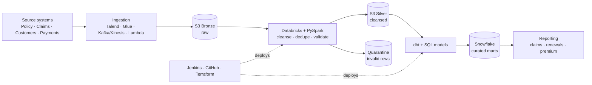

# Insurance Data Lakehouse — Reference Architecture (illustrative)

> **This is a reference architecture on synthetic data, not client work.**
> It shows how a modern insurance data platform is typically put together, using the kind of
> technology stack common in enterprise insurance. No client code, data, schemas or results are
> included, and no performance figures are claimed. Not every component here is connected exactly this
> way in any real environment.

## What I did vs. what I worked alongside

- **Hands-on:** Databricks, PySpark and Python (distributed processing, cleansing, deduplication, validation).
- **Working exposure (as part of the wider team and platform):** AWS services (S3, Glue, Lambda, Athena, Redshift),
  Snowflake, dbt, Talend, Kafka/Kinesis/Firehose, Jenkins, Terraform, GitHub, data catalog and governance tooling,
  and ServiceNow for incident handling.

## Business scenario

An insurer receives data from policy administration, claims management, customer/agent and payment systems.
The goal is to integrate them, improve data quality, process large volumes efficiently, protect sensitive
information, and publish trusted data for claims, renewals and premium analytics.

## Architecture



The tools do not all sit on one linear path. For example, dbt typically transforms warehouse data in
Snowflake, while PySpark handles large-scale transformation in Databricks.

## What is in this folder

| File | What it shows |
|---|---|
| `claims_silver_pipeline.py` | Bronze to silver PySpark pattern: type standardisation, keep-latest-version per claim, quarantine of invalid rows. Runs locally on synthetic data. |
| `snowflake_star_schema.sql` | A generic claims star schema and one example metric query. |

## Run the demo

```bash
pip install pyspark==3.5.1   # needs Java 8+ installed
python claims_silver_pipeline.py
```

Expected: 7 input rows become 6 after keeping the latest version of each claim, then 3 valid rows go to silver
and 3 invalid rows (missing id, missing amount, negative amount) go to quarantine instead of being silently dropped.

## Production considerations (not covered by the demo)

Schema evolution, late-arriving updates, restart-safe and idempotent loads, incremental processing, partitioning,
sensitive-data protection, and agreed business definitions for every metric.
